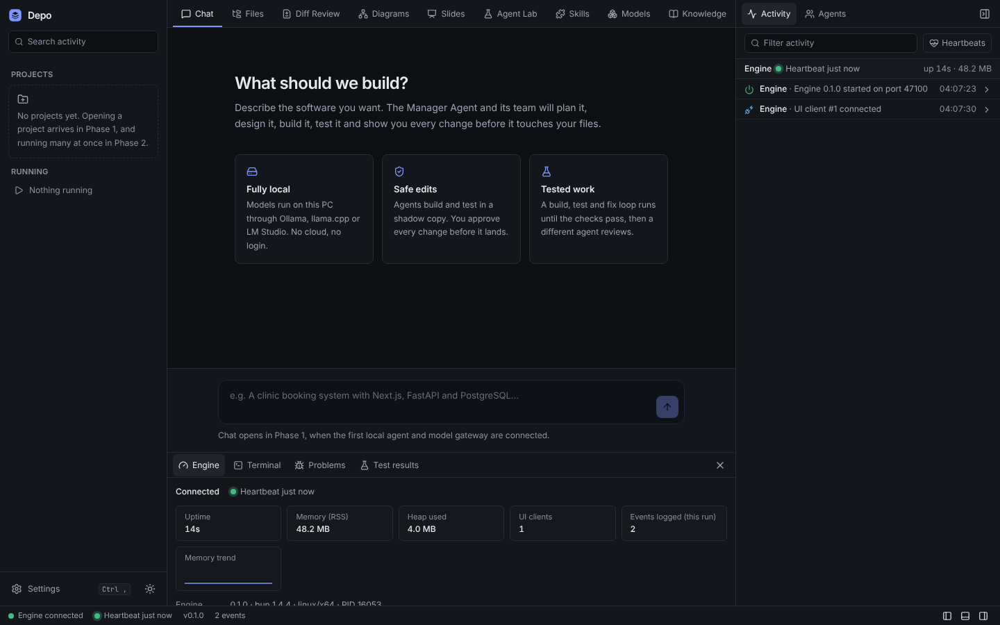

# Depo

A fully local, multi-agent AI coding studio for Windows. Describe the software you want; a team of local AI agents plans, designs, builds, tests, secures and documents it, and you approve every change before it touches your files. No cloud models, no accounts, no cost per token.

**Status:** Phase 0 (foundations) of 10. The desktop shell, engine, live activity feed and data layer work; agents and models arrive in Phase 1 and later. See [docs/PROGRESS.md](docs/PROGRESS.md).



## Build on Windows

### 1. Install the prerequisites (once)

| Tool | How |
|---|---|
| Bun 1.4+ | `powershell -c "irm bun.sh/install.ps1 \| iex"` |
| Rust (MSVC) | Install from <https://rustup.rs>, default host `x86_64-pc-windows-msvc` |
| Visual Studio 2022 Build Tools | Workload "Desktop development with C++" |
| WebView2 runtime | Already on Windows 11 and up-to-date Windows 10 |

Then, from this folder:

```powershell
powershell -ExecutionPolicy Bypass -File scripts\setup.ps1
```

It checks the tools above and runs `bun install`.

### 2. Run it

```powershell
bun run tauri:dev        # desktop window (builds the engine sidecar first)
bun run dev              # or: UI in a browser at http://127.0.0.1:1420 with a live engine
```

### 3. Test it

```powershell
bun run check            # lint + type-check + unit tests
bun run test:rust        # Rust tests
cd apps\desktop; bunx playwright install chromium; bun run test:e2e   # end-to-end + accessibility
```

### 4. Build the installers

```powershell
powershell -ExecutionPolicy Bypass -File scripts\build.ps1
```

Output: `apps\desktop\src-tauri\target\release\bundle\msi\Depo_0.1.0_x64_en-US.msi` and `...\bundle\nsis\Depo_0.1.0_x64-setup.exe`.

The installers are not code-signed yet, so Windows SmartScreen shows "Windows protected your PC". Choose **More info → Run anyway**.

## Where things live

- App data: `%LOCALAPPDATA%\Depo\` (database, logs, and later models, skills, workspaces). Set `DEPO_DATA_DIR` to use another folder.
- Logs: `%LOCALAPPDATA%\Depo\logs\engine.log` (JSON lines, secrets redacted).

## Repository

```
apps/desktop        Tauri 2 shell (src-tauri) + React UI (src) + e2e tests
packages/shared     Zod contracts shared by engine and UI
packages/engine     Bun sidecar: API server, event bus, SQLite, logging
docs/               PHASE-0, PROGRESS, ARCHITECTURE, DECISIONS
scripts/            dev, sidecar build, Windows setup and build
```

Read [docs/ARCHITECTURE.md](docs/ARCHITECTURE.md) for how the pieces fit and [docs/DECISIONS.md](docs/DECISIONS.md) for why.
