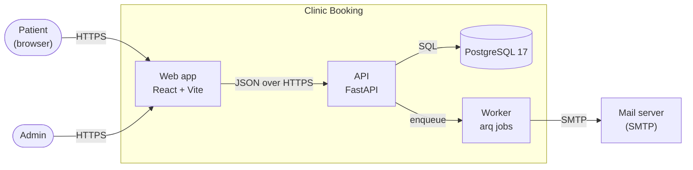
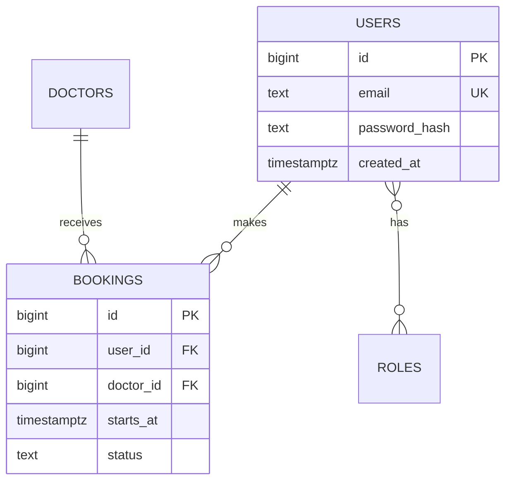
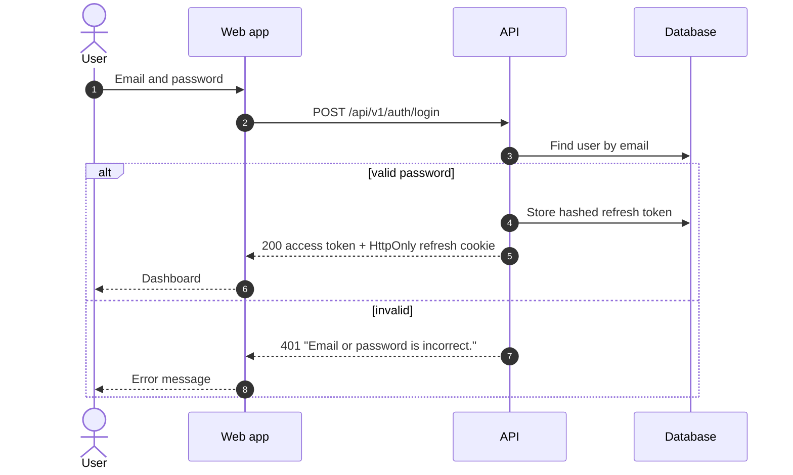
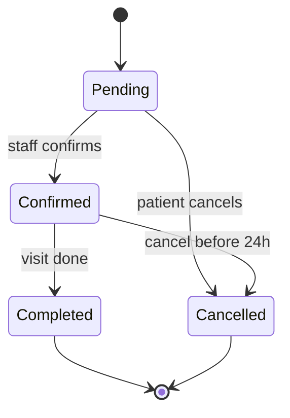
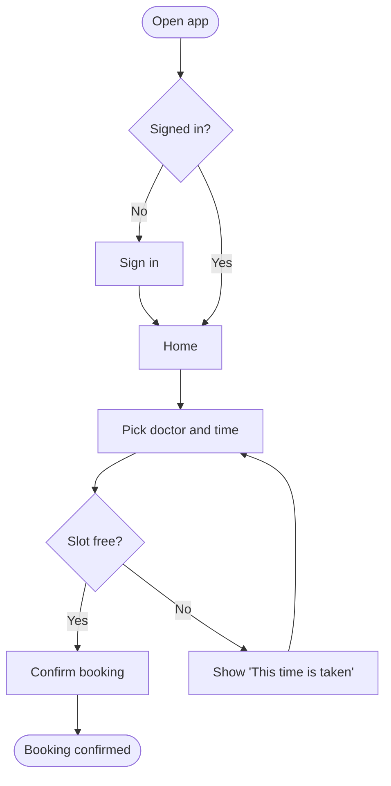

# Mermaid diagrams that render the first time

## C4 context and containers (use flowchart; Mermaid's C4 syntax is experimental)

Shapes: `[text]` box, `([text])` stadium (people), `[(text)]` cylinder (database), `{text}` decision. Directions: `LR`, `TD`.

## ERD from the real schema

Cardinality: `||` exactly one, `o|` zero or one, `}|` one or more, `}o` zero or more; `--` identifying (solid), `..` non-identifying (dashed). Attribute types must be one word (`timestamptz`, not `timestamp with time zone`); keys `PK`, `FK`, `UK`; an optional comment in double quotes after the key. Use the real table and column names.

## Sequence: login with refresh rotation

Arrows: `->>` call, `-->>` reply, `-x` failure. Blocks: `alt/else/end`, `opt/end`, `loop/end`, `par/and/end`. `Note over A,D: text` for notes.

## State diagram

## User flow

## Traps that break rendering
- Special characters in labels (parentheses, brackets, colons, slashes, quotes, `#`, `;`): wrap the label in double quotes: `A["POST /auth/login (JSON)"]`. Inside quoted labels use `#quot;` for a double quote.
- `end` as a node id or bare label in flowcharts breaks parsing: use `End` or `done`.
- Node ids: letters, digits and underscores only; labels go in brackets.
- Edge labels: `A -->|text| B` or `A -- text --> B`; quote them if they contain special characters.
- `subgraph id["Title"]` ... `end` on its own line.
- erDiagram entity names without spaces or hyphens (`ORDER_ITEMS`); relationship labels need text after the colon (use `""` for none).
- Comments with `%%` on their own line; no trailing semicolons needed.
- Keep under 40 nodes; split large systems into one diagram per container or flow.
Validate every file with render_diagram and fix the reported line before moving on.
